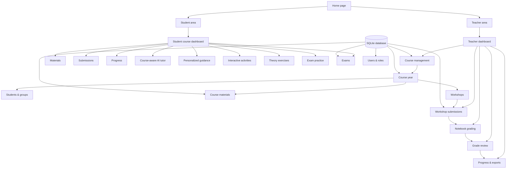

# GradeAgent Roadmap

## 1. Website foundations

- **Home page** — Explain GradeAgent and provide clear entry points for teachers and students.
- **Site navigation** — Add a consistent, responsive layout and navigation between pages.
- **Accounts and login** — Provide secure sign-in and prepare for teacher and student roles.
- **Database foundation** — Use SQLite initially, with models for users, courses, course years, groups, and submissions.
- **Teacher dashboard** — Show course cards, initially including *Machine Learning* and *Time Series Analysis* examples.

## 2. Courses and grading

- **Course management** — Create and manage courses and their yearly offerings.
- **Course overview** — Show students, groups, uploaded notebooks, grades, and summary statistics for the selected year.
- **Student and group management** — Associate students and groups with the correct course offering.
- **Workshop submissions** — Upload notebooks into the selected course, year, and workshop; use metadata to assist matching and ask for confirmation when uncertain.
- **Notebook grading** — Add an LLM grading engine with configurable rubrics and feedback.
- **Teacher grade review** — Let teachers review and adjust proposed grades before they are treated as final.
- **Course progress and exports** — Show student progress and allow teachers to export results.

## 3. Learning content and exercises

- **Course materials** — Organize lecture slides, links, and other resources by course and year, even when content is not yet available.
- **Student course dashboard** — Show enrolled courses, materials, submissions, and progress.
- **Theory exercises** — Provide questions, answers, and feedback organized by course topic.
- **Exam practice** — Offer practice questions and feedback without affecting official grades.
- **Exams** — Provide a separate framework for teacher-created assessments and submissions.

## 4. Personal learning agent

- **Course-aware AI tutor** — Answer student questions using the relevant course materials, with source references where available.
- **Personalized learning guidance** — Suggest topics and exercises based on a student’s progress and feedback.
- **Interactive learning activities** — Provide a framework for visualizations and activities, starting with a simple ML example.

## Suggested approach

Build the foundations first, then deliver course management and submissions before expanding into learning tools. Keep student data protected and clearly mark automated grades as proposals.

